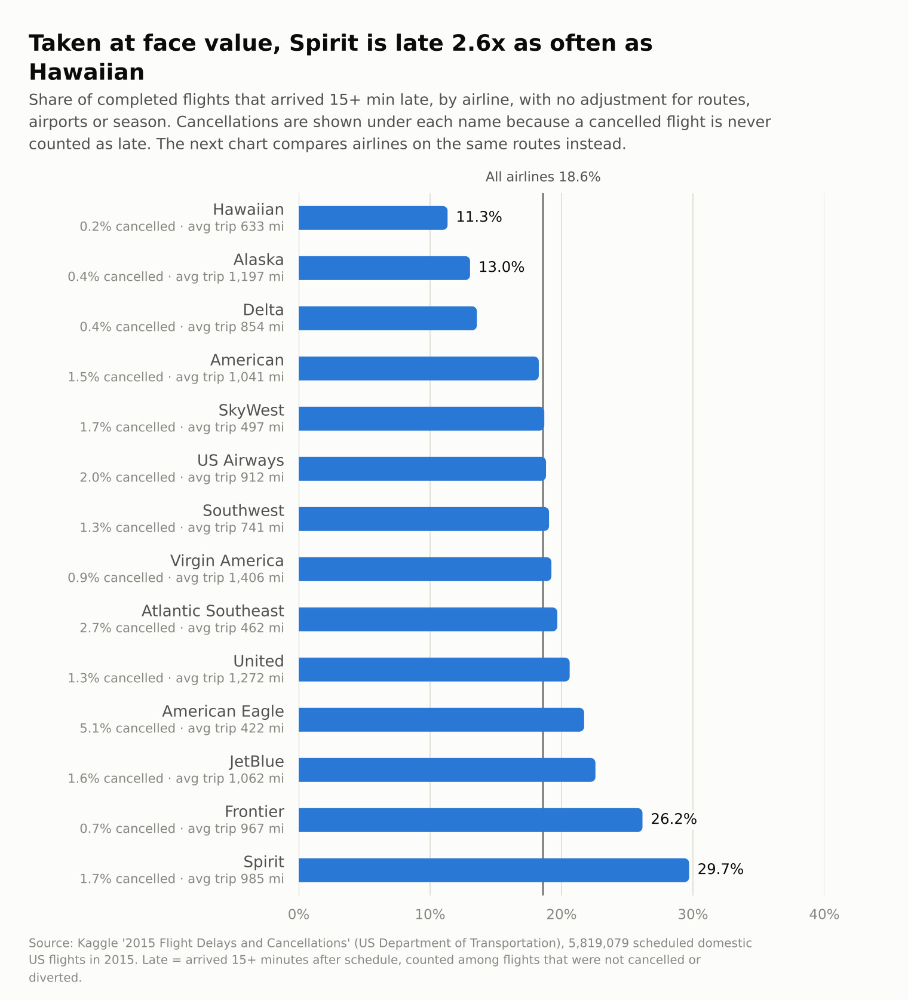
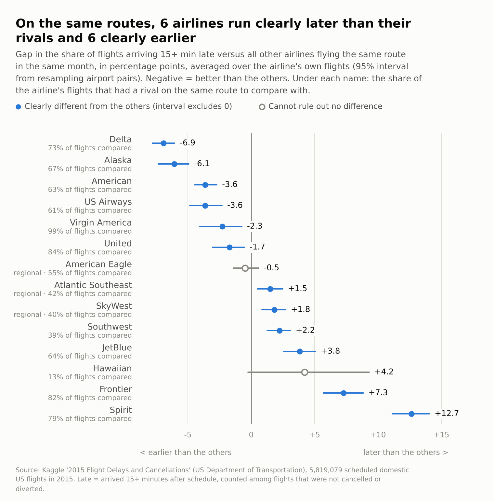
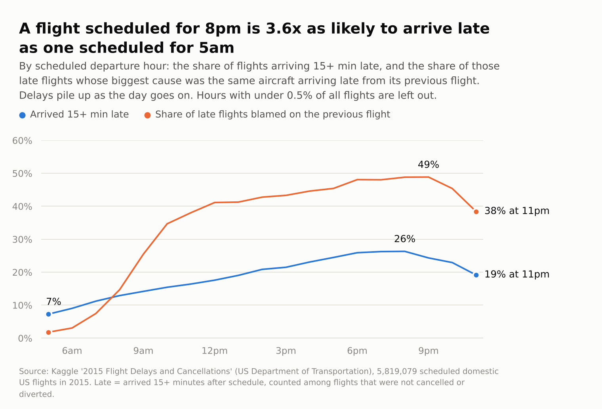

# Which US airlines are really late? A SQL analysis of 5.8 million flights

**Question:** how punctual are US airlines once you compare them on the *same routes*, what causes delays, and when and where do they happen?

**Data:** [2015 Flight Delays and Cancellations](https://www.kaggle.com/datasets/usdot/flight-delays) (Kaggle, from the US Department of Transportation). 5,819,079 scheduled domestic flights in 2015, 14 airlines, 322 airports.

**Tools:** SQL (SQLite, CTEs and window functions) for cleaning and analysis, Python (pandas, numpy, matplotlib) for loading, a bootstrap and the charts.

## Key findings

**Overall, 18.6% of completed flights arrive 15+ minutes late** (1,063,439 of 5,714,008), and 1.8% of scheduled flights never complete (89,884 cancelled, 15,187 diverted). Counting all three, 20.1% of scheduled flights were late, cancelled or diverted.

1. **On the same routes, Delta and Alaska are the most punctual airlines and Spirit and Frontier the least.** Delta arrives late 6.9 percentage points less often than the other airlines on the same route and month (95% interval 6.0 to 7.8) and Alaska 6.1 points less (4.9 to 7.3). Spirit is 12.7 points *more* often late (11.1 to 14.1) and Frontier 7.3 (5.7 to 8.8). Delta stays first, Alaska second and Spirit last in all six variations of the comparison, and Frontier is second-last in five of the six (see Robustness below).
2. **A plain league table misleads in the middle.** Southwest looks average on raw numbers (19.1% late vs 18.6% overall, 7th of 14), but on routes it shares with other airlines it arrives late 2.2 points more often than they do (1.2 to 3.1), 10th of 14. Virgin America moves the other way: 19.2% raw, but 2.3 points better than rivals (0.7 to 4.0).
3. **Hawaiian Airlines tops the raw table (11.3% late) but cannot be ranked.** Only 13% of its flights share a route with another airline, and on those the gap is +4.2 points with an interval of -0.3 to +9.3. Seven of the eight most punctual large routes are inter-island Hawaii routes with a single airline.
4. **Cancellations hide in the late rate.** American Eagle cancels 5.1% of its flights, 3.3x the 1.5% average. On lateness alone it looks no different from its rivals (-0.5 points, interval -1.4 to +0.6); counting cancellations and diversions as problems it is +0.9 points (interval -0.1 to +2.1).
5. **Delays snowball through the day.** A flight scheduled for 8pm is 3.6x as likely to arrive late as one scheduled for 5am (26.3% vs 7.3%). The share of late flights whose biggest cause is the same aircraft arriving late from its previous flight grows from 2% at 5am to 49% at 8pm.
6. **Planes recover only about 5 minutes in the air.** Of flights that leave 15+ minutes late, 79% still arrive 15+ minutes late; of flights that leave early, 3% do. Every departure group arrives 4.5 to 5.2 minutes better than it left, which suggests some slack in scheduled flight times.
7. **Late aircraft and airline problems account for most delay minutes; extreme weather for 5%.** Late aircraft 39.8%, airline (crew, maintenance, cleaning) 32.2%, air system (air traffic control, congestion, non-extreme weather) 22.9%, weather 4.9%, security 0.1%. Weather matters more for cancellations: 54% of cancelled flights were attributed to it. When weather does cause a late arrival it is the longest: 87 minutes on average vs 44 for air system delays.
8. **February is the worst month overall; June has the highest late rate.** 27.2% of February flights were late, cancelled or diverted, including 4.8% cancelled (September: 0.4%). June's late rate is 23.5%. September and October are the calmest months (13.5% and 13.0%). The worst single day was 27 January, with 19.0% of flights cancelled, and nine of the ten worst cancellation days fall between January and March.
9. **Airports differ a lot.** Among the 80 airports with 10,000+ departures, Baltimore (24.0%), Chicago Midway (23.8%) and Chicago O'Hare (23.3%) have the most departures leaving 15+ minutes late; Lihue (8.3%), Kailua-Kona (8.8%) and Honolulu (8.9%) the fewest. Salt Lake City handles 105,973 departures with 12.4% late, about half O'Hare's rate. LaGuardia cancels 4.3% of its departures.
10. **Smaller patterns.** Saturday is the best weekday (16.0% late), Thursday and Monday the worst (20.0% and 19.8%). Flight distance barely changes lateness (18.2% to 19.0%) but short flights (under 500 miles) are cancelled 2.5x as often as long ones (1,500+ miles).





More charts: [delay causes](charts/05_delay_causes.png), [months](charts/03_months.png), [worst days](charts/06_worst_days.png), [airports](charts/07_airports.png). Every chart has its numbers in `results/*.csv`.

### Airline table

Sorted by the gap to other airlines on the same routes in the same month (percentage points, 95% interval from resampling airport pairs; negative = late less often than rivals). "Flights compared" is the share of the airline's flights that had a rival on the same route-month.

| Airline | Late (raw) | Cancelled | Gap vs rivals, same routes | Verdict | Flights compared |
|---|---|---|---|---|---|
| Delta | 13.6% | 0.4% | -6.9 (-7.8 to -6.0) | earlier | 73% |
| Alaska | 13.0% | 0.4% | -6.1 (-7.3 to -4.9) | earlier | 67% |
| American | 18.3% | 1.5% | -3.6 (-4.5 to -2.7) | earlier | 63% |
| US Airways† | 18.8% | 2.0% | -3.6 (-4.8 to -2.3) | earlier | 61% |
| Virgin America | 19.2% | 0.9% | -2.3 (-4.0 to -0.7) | earlier | 99% |
| United | 20.6% | 1.3% | -1.7 (-3.0 to -0.5) | earlier | 84% |
| American Eagle (Envoy)* | 21.7% | 5.1% | -0.5 (-1.4 to +0.6) | unclear | 55% |
| Atlantic Southeast (ExpressJet)* | 19.7% | 2.7% | +1.5 (+0.5 to +2.5) | later | 42% |
| SkyWest* | 18.7% | 1.7% | +1.8 (+0.9 to +2.7) | later | 40% |
| Southwest | 19.1% | 1.3% | +2.2 (+1.2 to +3.1) | later | 39% |
| JetBlue | 22.6% | 1.6% | +3.8 (+2.6 to +5.1) | later | 64% |
| Hawaiian | 11.3% | 0.2% | +4.2 (-0.3 to +9.3) | unclear | 13% |
| Frontier | 26.2% | 0.7% | +7.3 (+5.7 to +8.8) | later | 82% |
| Spirit | 29.7% | 1.7% | +12.7 (+11.1 to +14.1) | later | 79% |

\* regional carrier, flying under bigger airlines' brands. † US Airways appears in the data only from January to June.

## What this could mean

- **Travellers:** an early flight is the simplest way to avoid a delay (7.3% of 5am flights arrive late, 26.3% at 8pm). In January to March also allow for cancellations: 2.2% to 4.8% of flights, against 0.4% to 1.8% in the other months.
- **Comparing airlines:** compare them on the same routes, and look at cancellations next to lateness. The three lowest raw late rates (Hawaiian, Alaska, Delta) also come with the fewest cancellations (0.2% to 0.4%), but Hawaiian's ranking does not survive the same-route check.
- **Airlines:** late aircraft is the largest cause of delay minutes (40%) and its share of late flights peaks in the evening, which points at slack between a plane's consecutive flights as the place to look first.

## What makes this analysis different

A plain league table of airlines partly measures *where they fly*: short hops out of congested hubs are late more often than flights out of quiet airports. So the headline comparison is **head-to-head on the same route in the same month**:

1. For every route-month (for example ATL to LGA in March) take one airline and all *other* airlines on that route.
2. Compare their late rates; average the gaps weighted by the airline's own flights.
3. Skip cells with fewer than 20 completed flights on either side, and report how much of each airline that leaves (`coverage_pct`).
4. Report cancellations and diversions next to lateness, because a cancelled flight is never "late" and an airline could look punctual by cancelling.
5. Give each gap a 95% interval from a bootstrap that resamples whole airport pairs (A to B and B to A together), because flights on a route share weather, congestion and airports.

```sql
-- inside every route-month cell: the airline vs everyone else on that route
tot.late - rm.late  AS o_late,   tot.comp - rm.comp AS o_comp
...
SUM(1.0 * comp * o_late / o_comp)  AS exp_late     -- late flights it would have at the others' rate
```

### Robustness

The same comparison re-run six ways (`03_robustness.py`, `results/r02_sensitivity.csv`). The second column is the rank correlation of the 14 airlines with the main comparison; the third counts airlines whose gap keeps its sign.

| Variation | Rank correlation | Same sign as main |
|---|---|---|
| finer: route + month + time of day | 0.98 | 14 of 14 |
| stricter: 2.5x minimum flights per side | 0.80 | 13 of 14 |
| late = 30+ min instead of 15+ | 0.93 | 12 of 14 |
| without October (rebuilt airport codes) | 1.00 | 14 of 14 |
| first half-year (Jan-Jun) | 0.98 | 13 of 14 |
| second half-year (Jul-Dec) | 0.96 | 13 of 13 |

The weakest agreement (stricter minimum) comes from Hawaiian Airlines, whose comparable flights drop to 3% of its total and whose gap changes sign. The 30-minute threshold shrinks every gap (Delta -4.6) without changing the order much. As a calibration check, the full-file gap fell inside the interval computed from a 3% random sample for all 14 airlines.

## How the analysis works

```
sql/01_clean.sql       airport-code repair, typed flights table, flags, route-month counts
sql/02_analysis.sql    20 named queries: monthly, hourly, airlines (raw and fair), airports, causes, ...
run_analysis.py        loads the CSV in chunks into SQLite, runs both SQL files, writes results/*.csv
03_robustness.py       bootstrap intervals and sensitivity checks for the airline comparison
04_charts.py           builds charts/*.png from results/
tools/make_sample.py   makes a 3% sample and a profile of the full file (for testing on a laptop)
```

### Run it yourself

1. Download `flights.csv`, `airlines.csv` and `airports.csv` from the Kaggle link above (free account) into a `data/` folder.
2. `pip install -r requirements.txt`
3. Run in order:

```
python run_analysis.py data/flights.csv
python 03_robustness.py
python 04_charts.py
```

The full file takes about 4 minutes for step 1 (254 seconds in the run behind these results) and needs about 1 GB of memory and 1.5 GB of free disk (temporary; `data/flights.db` is 879 MB). It also works on a sample (`tools/make_sample.py` makes one): size thresholds then scale down automatically and every chart is labelled as a preview. `results/run_info.json` records which file was used. The `data/` folder is not committed.

## Data cleaning decisions

- **October airport codes.** Every flight in October (486,165 rows) has a numeric airport ID such as `10397` instead of a 3-letter code such as `ATL`, and the dataset ships no lookup. The IDs were matched to codes using the data itself: a flight (same airline, flight number, scheduled departure and distance) flies the same route in other months, so its October IDs vote for the codes it has elsewhere. A code is accepted only with 3+ votes, at least 90% agreement, and no other ID claiming the same code. This mapped 301 IDs (every one with at least 7 votes and 96.6% agreement), so 485,467 of 486,165 October rows (99.86%) have both airports identified. The other 698 rows keep their numeric ID for airline comparisons and are left out of the airport table. The map is in `results/q20_airport_id_map.csv` so it can be audited.
- **How the map was checked.** The 15 busiest numeric IDs map to ATL, ORD, DFW, DEN, LAX, SFO, IAH, PHX, LAS, MSP, SEA, BOS, DTW, EWR, CLT, the airports they should be. On a 3% sample, the great-circle distance between the mapped airports (from `airports.csv` coordinates) is within 25 miles or 5% of the `DISTANCE` column for all 14,248 checkable October rows (99.98% for the other months). That second check is a consistency check, not independent proof, because distance is part of the matching key. `03_robustness.py` also re-runs the airline comparison without October.
- **Cancelled and diverted flights have no arrival delay** (checked: exactly the rows with an empty `ARRIVAL_DELAY`). They are kept and counted as "problem" flights next to the late rate, not dropped.
- **Late = 15+ minutes** after the scheduled arrival (the US DOT definition), among flights that were neither cancelled nor diverted.
- **Delay causes** (air system, security, airline, late aircraft, weather) are filled only for flights 15+ minutes late, and add up to the arrival delay. Each late flight is assigned its largest cause; exact ties (0.8% of late flights) are reported as "Tie".
- Extreme delays (up to 1,971 minutes) are kept; the analysis uses rates, not averages.
- All consistency checks in `results/q19_data_quality.csv` pass, including no exact duplicate flights.

## Limitations

- **One year (2015), domestic flights only.** Airline rankings change over time, and the intervals describe sampling noise within 2015, not year-to-year variation.
- **Observational data.** The comparison controls for route and month (and, in a robustness run, time of day), not for aircraft type, gates or terminals.
- **Airline is not the same as brand.** SkyWest, Atlantic Southeast/ExpressJet and American Eagle fly regional flights under the names of bigger airlines, so passengers may not see the carrier they booked with.
- **US Airways has flights only from January to June.** In a 3% sample American's monthly flight count roughly doubles in July, which fits US Airways flights being reported under American from then on. US Airways' result therefore covers six months only, and American's second half includes its former flights.
- **Delay is measured against the airline's own schedule.** Flights in every departure group arrive about 5 minutes better than they left, so an airline that pads its schedule looks more punctual.
- **Causes are reported by the airlines.** Following the [BTS definitions](https://www.bts.gov/topics/airlines-and-airports/airline-time-performance-and-causes-flight-delays), "weather" is only extreme weather as judged by the carrier; non-extreme weather is filed under the national air system. Late aircraft is a knock-on effect of earlier problems, not a root cause.
- **Coverage is below 100%** for most airlines, because routes served by one airline cannot be compared. For Southwest (39%), SkyWest (40%), ExpressJet (42%) and Hawaiian (13%) the result describes only their contested routes.
- **The October airport map is derived, not official**, and the airport table skips 698 flights from airports it could not identify.

## Data source

Kaggle dataset "2015 Flight Delays and Cancellations" (US Department of Transportation). The raw data is not included here; download it from Kaggle and follow its licence terms.
